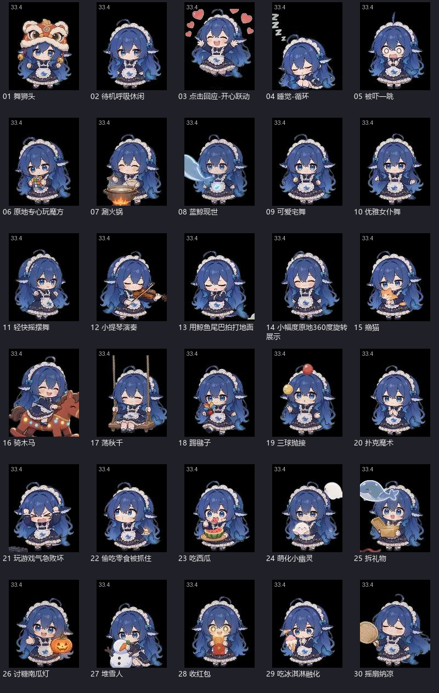

# deepseek_in_esp32s3

一只住在 **ESP32-S3 + 1.8 寸彩屏** 上的鲸鱼娘桌宠。无需 SD 卡，30 个动作保存在板载 Flash，支持完整播放、大尺寸统一视窗、平滑切换、BOOT 按键互动，以及 DeepSeek 余额显示。

当前版本：**v7.1 · 固定大尺寸与平滑切换**。已在 ESP32-S3 N16R8 / ST7735S 128×160 上完成实机验证。

> **许可**：程序代码采用 [MIT](LICENSE) 许可；`assets/`、`legacy/`、`docs/images/` 中的角色美术与动画素材采用 **CC BY-NC-SA 4.0**（署名 · 非商业 · 相同方式共享），署名与条款见 [ASSET_LICENSE.txt](ASSET_LICENSE.txt)。



> 上图为同尺寸离线合成预览，余额数字仅作示意。人物以统一的大尺寸显示，部分大型道具与边缘特效会自然延伸到视窗外。

## 快速开始

**只想让桌宠跑起来 —— 不用装 Arduino 环境：**

```powershell
python -m pip install esptool
cd prebuilt
.\flash.ps1 -Port COM4
```

仓库里已经带好编译通过的固件、分区表和动画包，一条命令写完四个区域。固件使用占位符凭据，**动画与按键交互正常，余额显示不可用**；细节见 [prebuilt/README.md](prebuilt/README.md)。

**想改代码 —— 从源码编译：**

```powershell
Copy-Item .\secrets.example.h .\secrets.h        # 填入自己的 WiFi 与 DeepSeek API Key
powershell -NoProfile -ExecutionPolicy Bypass -File .\build.ps1 -Upload -Port COM4
```

需要先按「环境准备」装好 Arduino CLI、ESP32 支持包和依赖库。两条路都**不需要**安装 Python 图像依赖，也**不需要**联网重建素材 —— `generated/pet-assets.bin` 已在仓库内。

## 功能

- **30 个完整动作**：开机先播舞狮头，之后洗牌轮播；每个动作 120 帧，完整时长约 10.04 秒。
- **人物够大、切换稳定**：站立人物约 132 像素高。所有动作共用同一缩放和坐标基准，避免因道具大小不同而忽大忽小、左右跳变。
- **平滑过渡**：动作播完后进行 4 步交叉淡化，实测约 162ms；过渡不会吃掉下一动作的第一帧或播放时长。
- **按键互动**：短按 BOOT 请求开心跃动；长按至少 1 秒再松开，请求舞狮头。当前动作播完后执行。
- **余额显示**：后台约每 60 秒查询一次 DeepSeek 余额；正常浅灰、低余额暖色提醒，文字不参与淡化。
- **整帧推屏**：内存合成后通过 40MHz SPI 推屏；网络查询独立运行，不阻塞动画。

动画可离线播放；余额查询需要可用的 2.4GHz WiFi、互联网连接和用户自己的 DeepSeek API Key。

## 硬件与接线

| 部件 | 已验证配置 |
|---|---|
| 主控 | ESP32-S3 DevKitC-1 兼容板，N16R8：16MB Flash + 8MB PSRAM |
| 屏幕 | 1.8 寸 ST7735S，128×160，SPI 接口 |
| 供电 / 下载 | USB，CH340 串口 |
| 交互 | 板载 BOOT，GPIO0 |
| 额外存储 | 不需要 SD 卡；当前程序无需启用 PSRAM |

| 屏幕引脚 | ESP32-S3 |
|---|---|
| BLK | 3V3 |
| CS | GPIO10 |
| DC | GPIO9 |
| RES | GPIO8 |
| SDA / MOSI | GPIO11 |
| SCL / SCK | GPIO12 |
| VCC | 3V3 |
| GND | GND |

屏幕电源使用 **3.3V**。当前初始化为 `INITR_BLACKTAB`，竖屏 `rotation=0`。其他屏幕批次可能需要核对初始化参数。

## 目录结构

```text
deepseek_in_esp32s3/
├── README.md
├── deepseek_in_esp32s3.ino                  # 当前主程序
├── secrets.example.h             # 本地配置模板，不含真实凭据
├── actions.json                  # 30 动作清单、来源路径与 Git blob SHA
├── partitions.csv                # 16MB Flash 分区表
├── pet_assets.h                   # 当前动画包的生成索引
├── build.ps1                     # 编译 / 一次性烧录程序与动画
├── verify_device.ps1             # 实机完整播放与过渡校验
├── prebuilt/                     # 免编译固件与 flash.ps1，见 prebuilt/README.md
├── requirements-assets.txt       # 素材处理依赖
├── ASSET_LICENSE.txt             # 素材来源与授权
├── tools/
│   ├── build_pet_assets.py        # 校验、转码、打包动画
│   └── package_project.py        # 生成不含私密配置的本地整理包
├── generated/                    # 现成动画包，已入库（clone 后可直接烧录）
│   ├── pet-assets.bin
│   ├── asset-report.json
│   └── action-contact-sheet.png
├── assets/pc2005/                # 离线包包含清单内的 30 段原视频
├── docs/
│   ├── images/                   # README 预览
│   └── validation/               # 已验证的设备结果
└── legacy/rgb565/                # 旧版转换脚本、头文件与 PNG/GIF 素材
```

实际开发工程可位于其他目录；Arduino 主 `.ino` 文件名必须与所在文件夹名称一致。整理包会使用 `deepseek_in_esp32s3.ino`，与顶层文件夹同名。如果以后下载的仓库目录带 `-main` 后缀，编译前请改回 `deepseek_in_esp32s3`。

## 环境准备

以下是本项目已经使用并验证的版本：

| 组件 | 版本 |
|---|---|
| Arduino CLI | 1.5.1 |
| ESP32 Arduino 支持包 | 3.2.1-cn |
| Adafruit ST7735 and ST7789 Library | 1.12.0 |
| Adafruit GFX Library | 1.13.0 |
| Adafruit BusIO | 1.17.4 |
| ArduinoJson | 7.4.3 |
| TJpg_Decoder | 1.1.0 |
| Python（重建素材时使用） | 本机验证为 3.13 |
| Pillow / imageio-ffmpeg | 见 `requirements-assets.txt` |

在 Arduino IDE 或 Arduino CLI 中安装 ESP32 支持包及以上库。`3.2.1-cn` 是本机使用的镜像版；其他支持包版本需要重新编译并检查实际运行。

构建脚本依次支持 `-Cli` 指定路径、`ARDUINO_CLI` 环境变量、PATH 中的 `arduino-cli`，以及常见 Arduino IDE 安装位置。找不到时传入实际路径即可。

仓库和离线包都已包含生成好的动画（`generated/pet-assets.bin`）。**只编译和烧录时，不需要重新转码或安装 Python 图像依赖。** 修改动画时再执行：

```powershell
python -m pip install -r .\requirements-assets.txt
```

## 配置 WiFi 和余额查询

在项目根目录执行：

```powershell
Copy-Item .\secrets.example.h .\secrets.h
```

在本机编辑 `secrets.h`，填写自己的配置：

```cpp
#define WIFI_SSID     "YOUR_2_4_GHZ_WIFI"
#define WIFI_PASS     "YOUR_WIFI_PASSWORD"
#define DEEPSEEK_KEY  "YOUR_DEEPSEEK_API_KEY"
```

`secrets.h` 被 `.gitignore` 排除，整理包只包含模板。自行编译的固件会包含这些凭据，因此 `.build/`、固件 `.bin`、`.elf` 等也不会进入整理包。

## 编译与烧录

在项目根目录打开 PowerShell：

```powershell
# 只编译，复用生成好的动画
powershell -NoProfile -ExecutionPolicy Bypass -File .\build.ps1

# 查询实际串口（需 arduino-cli 在 PATH 中）
arduino-cli board list

# 编译并同时烧录固件、分区表和动画；COM4 仅为示例
powershell -NoProfile -ExecutionPolicy Bypass -File .\build.ps1 -Upload -Port COM4

# CLI 未在 PATH 中时，显式传入实际安装路径
powershell -NoProfile -ExecutionPolicy Bypass -File .\build.ps1 -Cli "C:\path\to\arduino-cli.exe" -Upload -Port COM4
```

固定编译目标：

```text
esp32:esp32:esp32s3:FlashSize=16M,PartitionScheme=custom
upload.maximum_size=2097152
```

**必须保留项目内的 `partitions.csv`，并将动画包与固件配套烧录。** 脚本通过同一次 esptool 调用写入程序和 `0x210000` 位置的动画包。完整烧录需要几分钟。

## 修改或重建动画

1. 在 `actions.json` 中调整素材清单及来源校验值；当前版本固定 30 个动作，舞狮头索引为 0。
2. 需要调整画面时，统一修改 `tools/build_pet_assets.py` 中的相机参数。
3. 重建素材并重新编译：

```powershell
powershell -NoProfile -ExecutionPolicy Bypass -File .\build.ps1 -RebuildAssets
# 或仅重建动画，不编译 / 烧录
python -X utf8 .\tools\build_pet_assets.py --quality 65
```

有效缓存会先经过 Git blob SHA 校验；缺少缓存时脚本从上游下载。原始视频不执行任何插件代码。若上游文件内容变化，校验会失败，应先核对来源再更新清单。

统一画面参数如下，**不要重新按每段道具的包围框分别缩放、居中**：

| 参数 | 当前值 |
|---|---|
| 源画布 | 640×360 |
| 原视频 / 播放帧率 | 24fps → 12fps，保留完整时间轴 |
| 缩放比例 | 0.48，30 个动作一致 |
| 素材基准点 | `(320,330)` |
| 屏幕基准点 | `(64,158)` |
| 动画区域 | 128×148，屏幕 y=12..159 |
| 余额区域 | 顶部 12 像素，文字从 `(4,4)` 开始 |

人物保持统一大尺寸，跳跃、坐下等原动作变化仍保留；为满足小屏上看清人物的目标，大型道具及边缘特效允许出屏。

## 存储与渲染原理

- 16MB Flash：应用分区 2MB；动画分区从 `0x210000` 开始，大小 `0xDE0000`；末尾保留 coredump。
- 当前动画包 **14,074,204 字节**，分区剩余 **474,788 字节**。
- 使用基线 JPEG，quality=65。所有帧共用的 177 字节头只存一次，节省 637,023 字节重复数据；存储格式版本为 8。
- 固件将公共头和每帧数据拼回完整 JPEG，验证 CRC32 后解码成 RGB565；单帧 JPEG 最大 5,103 字节。
- 两个 128×160 RGB565 缓冲用于整帧合成与过渡。余额文字独立合成，不参与淡化。
- 背景任务查询余额，主循环接收队列结果；每段动画完整结束后才切换。

## 设备验证

串口未被其他程序占用时执行：

```powershell
powershell -NoProfile -ExecutionPolicy Bypass -File .\verify_device.ps1 -Port COM4
```

校验约需 5 分钟，会顺序播放全部动作，并核对帧数、完整时长、CRC/JPEG 错误、过渡步骤和余额状态。结果写入 `.build/device-validation-v7_1.json` 与日志。

2026-11-12 已在上述硬件完成验证，原始结果见 [设备验证记录](docs/validation/device-validation-v7_1.json)：

| 项目 | 结果 |
|---|---|
| 动作 / 帧数 | 30/30 动作，3600/3600 帧 |
| 过渡 | 30/30 次，均为 4 步、162ms |
| 每段动作时长 | 10,040ms，过渡不计入动作时间 |
| 最慢单帧处理 | 40ms |
| CRC / JPEG 错误 | 0 |
| 余额刷新 | 正常 |
| 程序空间 | 1,129,530 / 2,097,152 字节 |
| 静态 RAM | 96,516 / 327,680 字节 |

这些是已完成的 v7.1 实机记录，不代表修改配置、硬件或支持包后仍自动通过同样测试。

串口波特率为 115200，支持：

| 命令 | 用途 |
|---|---|
| `?` | 查询动作、帧数、余额是否就绪、WiFi 状态和空闲内存 |
| `P0`…`P29` 加换行 | 当前动作播完后点播对应动作 |
| `T` | 排队开始完整 30 动作测试 |
| `X` | 取消测试模式，当前动作仍完整播放 |

测试完成后恢复舞狮头和正常轮播。诊断日志不输出 WiFi 密码、API Key 或余额金额。

## 动作清单

| 索引 | 动作 | ID |
|---|---|---|
| 00 | 舞狮头 | `lion` |
| 01 | 待机呼吸休闲 | `idle` |
| 02 | 点击回应-开心跃动 | `happy` |
| 03 | 睡觉-循环 | `sleep` |
| 04 | 被吓一跳 | `alert` |
| 05 | 原地专心玩魔方 | `cube` |
| 06 | 涮火锅 | `hotpot` |
| 07 | 蓝鲸现世 | `blue_whale` |
| 08 | 可爱宅舞 | `otaku_dance` |
| 09 | 优雅女仆舞 | `maid_dance` |
| 10 | 轻快摇摆舞 | `swing_dance` |
| 11 | 小提琴演奏 | `violin` |
| 12 | 用鲸鱼尾巴拍打地面 | `tail_drums` |
| 13 | 小幅度原地360度旋转展示 | `spin` |
| 14 | 撸猫 | `pet_cat` |
| 15 | 骑木马 | `rocking_horse` |
| 16 | 荡秋千 | `swing` |
| 17 | 踢毽子 | `shuttlecock` |
| 18 | 三球抛接 | `juggling` |
| 19 | 扑克魔术 | `card_magic` |
| 20 | 玩游戏气急败坏 | `gaming` |
| 21 | 偷吃零食被抓住 | `sneak_snack` |
| 22 | 吃西瓜 | `watermelon` |
| 23 | 萌化小幽灵 | `ghost` |
| 24 | 拆礼物 | `gift` |
| 25 | 讨糖南瓜灯 | `pumpkin` |
| 26 | 堆雪人 | `snowman` |
| 27 | 收红包 | `red_envelope` |
| 28 | 吃冰淇淋融化 | `ice_cream` |
| 29 | 摇扇纳凉 | `fan` |

## 常见问题

| 现象 | 检查方向 |
|---|---|
| 找不到 `arduino-cli` | 使用 `-Cli`，或设置 `ARDUINO_CLI` / PATH |
| 提示缺少 `secrets.h` | 从 `secrets.example.h` 复制并在本机填写 |
| 找不到同名 `.ino` | 主文件与文件夹名称必须一致 |
| `assets not ready` | 固件、`pet_assets.h`、动画包和分区表是否为同一版本；用 `build.ps1 -Upload` 一起烧录 |
| 固件装不下 | 核对 FlashSize=16M、自定义分区与 2MB 程序上限；不要改回旧的 huge_app 配置 |
| 串口无法打开 | 重新枚举端口，关闭 Arduino 串口监视器等占用程序 |
| 屏幕白屏或颜色异常 | 核对接线、ST7735 初始化和 RGB565 字节序 |
| 不显示余额 | 检查 2.4GHz WiFi、网络连接和个人 API Key；动画仍可离线播放 |
| 动作切换又忽大忽小 | 是否恢复了按动作单独裁边、缩放的旧逻辑 |

## 本地整理包

`tools/package_project.py` 采用明确的文件清单打包，包含当前代码、历史 RGB565 代码、30 段已校验原视频、动画包、预览与验证记录；不包含真实 `secrets.h`、编译固件、缓存和调试产物。

```powershell
python -X utf8 .\tools\package_project.py --output ..\deepseek_in_esp32s3-v7.1.zip
```

压缩包附带 `PACKAGE_MANIFEST.json` 文件校验清单，外部 `.zip.sha256` 可用于检查整个压缩包。生成整理包不涉及 GitHub 登录、创建仓库或推送。

## 素材来源与授权

30 个动作来自 [PC2005-cloud/dsh-pet](https://github.com/PC2005-cloud/dsh-pet)。历史五动作素材来自 [luweiyabo/dsh-whale-pet](https://github.com/luweiyabo/dsh-whale-pet)。

角色原型“溟月”来自 B 站 **@上善无形**，DeepSeek 女仆鲸鱼娘设计来自 **@ZipZipPipe**。上游注明形象素材遵守 **CC BY-NC-SA 4.0（署名、非商业、相同方式共享）**；上游程序代码的 MIT 许可不替代形象素材许可。

完整署名与素材使用说明见 [ASSET_LICENSE.txt](ASSET_LICENSE.txt)。依赖库保留各自许可，本项目未打包这些库的源码。
